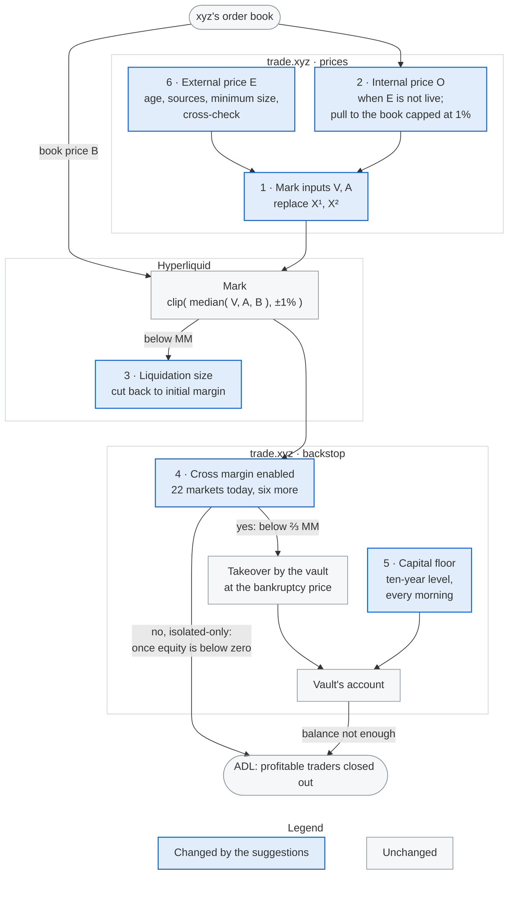

# trade.xyz backstop study

Suggestions for how trade.xyz prices and liquidates positions on Hyperliquid in stressed markets, studied from outside,
with the replay engine and data pipeline behind every number.

## The suggestions in one paragraph

Today the prices trade.xyz publishes follow the external price in steps of 0.5% per update, so in a fast move the mark
arrives about a minute late, and a single wrong external price moves it on its own. The suggestions aim to reduce
potential ADL and improve how the backstop vault performs. The main one is for the mark (changes 1 and 2): the mark
becomes the middle of three votes, the external price, a 30-minute anchor of it, and xyz's own order book; and one
capped rule prices the market whenever the external price is not live. Both change only what trade.xyz's relayer
publishes; Hyperliquid's mark formula is unchanged. Four more: a liquidation size that cuts a large position back to
its initial margin (change 3, a Hyperliquid change), six more markets for the backstop vault (4), a daily floor for
the vault's capital (5), and three items for the external price (6). *The proposal* means changes 1 to 3, replayed
together.

## Where each change sits



Each box is a part of the protocol; each arrow is a real input or outcome. Colors as in the paper. A position below its maintenance margin (MM) is sold into xyz's book. On a market with
cross margin enabled, the vault takes it over below ⅔ MM; on an isolated-only market the book keeps selling and ADL
comes once its equity is below zero. ADL also comes when the vault's balance is not enough.

| Change | Where it sits | Who would make it | Paper |
|---|---|---|---|
| 1 · Mark inputs: the feed's vote V and its 30-minute anchor A replace X¹ and X² | trade.xyz's relayer | trade.xyz | [page 6](docs/mark_formulas.pdf#page=6) |
| 2 · Internal price when E is not live: pull toward the book capped at 1%, also when E repeats | trade.xyz's relayer | trade.xyz | [page 7](docs/mark_formulas.pdf#page=7) |
| 3 · Liquidation size: cut back to initial margin at every update | Hyperliquid's liquidation engine | Hyperliquid | [page 8](docs/mark_formulas.pdf#page=8) |
| 4 · Cross margin enabled on six more markets: Robinhood, MicroStrategy, Nebius, AMD, EWY, Samsung | the market's setting | trade.xyz, reviewed by Hyperliquid's validators | [page 9](docs/mark_formulas.pdf#page=9) |
| 5 · A floor for the vault's capital, recomputed every morning | the vault's capital | trade.xyz (a suggestion, not a protocol rule) | [page 11](docs/mark_formulas.pdf#page=11) |
| 6 · External price published with its age and sources; a minimum size overnight; a cross-check | trade.xyz's price pipeline | trade.xyz | [page 12](docs/mark_formulas.pdf#page=12) |

Changes 1 and 2 go together, 3 after them, 4 with the capital it needs, 5 and 6 at any time ([page 13](docs/mark_formulas.pdf#page=13)).

## What changes in the formulas

| | Today | Suggested |
|---|---|---|
| **Oracle**, feed live (1) | $`O_t = \mathcal{D}_t\big(\mathrm{clip}(E_t,\ O_{t-k}(1\pm c))\big)`$ | $`O_t = {\color{#2F74D0}\mathcal{D}_t(E_t)}`$ |
| **First input** (1) | $`X^1_t = \mathcal{D}_t\big(\mathrm{clip}(O_t,\ M_{t-1}(1\pm c))\big)`$ | $`X^1_t = {\color{#2F74D0}V_t}`$, with $`{\color{#2F74D0}V_t = E_t}`$ if the feed is live, else $`{\color{#2F74D0}O_t}`$ |
| **Second input** (1) | $`X^2_t = \mathcal{D}_t\big(\mathrm{clip}(E_t + e_t,\ H_t)\big)`$ | $`X^2_t = {\color{#2F74D0}A_t}`$, from $`{\color{#2F74D0}\tilde A_t = A_{t-1} + \big(1 - e^{-\Delta t/\tau}\big)(V_t - A_{t-1})}`$, then a correction step |
| **Mark** (Hyperliquid) | $`M_t = \mathrm{clip}\big(\mathrm{med}(X^1_t, X^2_t, B_t),\ M_{t-1}(1\pm 1\%)\big)`$ | $`M_t = \mathrm{clip}\big(\mathrm{med}({\color{#2F74D0}V_t}, {\color{#2F74D0}A_t}, B_t),\ M_{t-1}(1\pm 1\%)\big)`$ |
| **Feed not live** (2) | in closures or a data gap: $`O_t = O_{t-1} + \big(1 - e^{-\Delta t^*/\tau}\big)(\text{mid}_t - O_{t-1})`$ | in closures $`{\color{#2F74D0}\text{or when } E_t = E_{t-1} = E_{t-2}}`$: $`O_t = O_{t-1} + \big(1 - e^{-\Delta t^*/\tau}\big)\,{\color{#2F74D0}\mathrm{clip}\big(\text{mid}_t - O_{t-1},\ \pm\kappa\,O_{t-1}\big)}`$ |
| **Liquidation size** (3) | below MM, above \$100k: a first 20%, then full size during a 30 s cooldown | below MM, above \$100k, at every update: $`{\color{#2F74D0}\Delta q = \big(1 - \text{equity}/\text{IM}\big)\,\lvert q\rvert}`$ |

Blue: what differs from today, as in the paper; (1) to (3): the change. $`c = 0.5\%`$, today's limit per update; $`k`$: the relayer's read lag; $`\mathcal{D}_t`$: the discovery bound; $`e_t`$: the 150 s average of mid $`-\,E`$; $`H_t`$: the range spanned by $`O_{t-k}(1\pm c)`$ and $`X^2_{t-k}(1\pm c)`$; $`\kappa = 1\%`$; $`\tau = 30`$ min. The correction step of $`A_t`$ and every other rule: [page 3](docs/mark_formulas.pdf#page=3).

**[Rule explorer](https://ymsynn.github.io/xyz-backstop-study/)**: recorded market days replayed under today's rules
and the suggested ones, on the same charts. Pick a test, change a part of the formulas and compare, in the browser.

| Document | What it is |
|---|---|
| [docs/mark_formulas.pdf](docs/mark_formulas.pdf) | The paper: six suggestions, the tests, their costs and limits (31 pages). Every rule, today's and the suggested one, side by side on page 3. |
| [docs/variant_history.pdf](docs/variant_history.pdf) | Companion note: the variants tried before the proposal and why each was dropped. The paper does not depend on it. |
| [docs/formulas_now_vs_proposal.pdf](docs/formulas_now_vs_proposal.pdf) | One page: today's formulas and the suggested ones, every changed term highlighted. |
| [docs/spec/proposal_spec.md](docs/spec/proposal_spec.md) | Specification of the two values the relayer would publish, with a reference implementation and a test vector. |
| [docs/results/](docs/results/) | The result tables behind the paper, one file per test. |

## Results

About 85 recorded market-days, replayed under today's rules and the proposal. Today's figure first. Full table:
[docs/results/scorecard.md](docs/results/scorecard.md).

| Test | Today | Proposal |
|---|---|---|
| A 5% wrong external price for 30 seconds (Alphabet): how far the mark moves | 4.17% | 0.10% |
| The same test: healthy positions handed to the vault | $920k | $0 |
| Order-book push for 15 minutes while crude oil's market is closed: how far the mark moves | 6.56% | 0.81% |
| Five replays of isolated-only markets: ADL | $300.4k | $99.5k |
| Three earnings crashes together: money the vault needs to avoid ADL | $462k | $352k |
| Takeovers by the vault on two oil markets, September 10 | 95 | 13 |
| Takeovers by the vault on five other market-days held out of the design | 8 | 11 |
| Alphabet's earnings crash: positions the vault inherits | $6.96M | $10.28M |
| External price walked 10% overnight, with a push on xyz's book: positions liquidated | $15.5M | $16.0M |
| 33 markets on November 5: ADL on isolated-only markets | $154k | $64k |

## What it costs

Every case where the proposal does worse than today, no better, or was not tested: page 21; limits: page 22. The main
ones:

- **In most tests the vault inherits more than today** (Alphabet's crash: $6.96M today, $10.28M). It inherits less on
  Intel, on Amazon within the replay's error, and on the two oil markets of September 10.
- **When a market's venue is closed, the mark can sit above xyz's book for hours** (SK Hynix, July 27: up to 7.03%).
  The replay of that day is indeterminate: its result rests on a recorded book that today's rule had held in place.
- **A walked external price combined with a push on xyz's book does as much harm as today, or more.** A wrong price
  that lasts moves the mark slowly, not at all only when it is short.
- **The cut-back needs a Hyperliquid change**, and on its own it is not shown to do better than today.
- **The replay does not model market makers reacting** to a wrong published price, uses a reconstruction of today's
  relayer, and was tuned on the same days it was tested on, apart from the held-out and random ones.

## Layout

| Path | What it is |
|---|---|
| `engine/` | The replay engine (Rust): Hyperliquid's matching, margin, liquidation and backstop rules, and a model of trade.xyz's relayer. A suggested rule is a switch in this engine. |
| `sim/` | `pipe_day.sh`, which builds one replayable market-day by calling the steps in `sim/prep/`; `pkgm_env.zsh`, the proposal's engine settings; `figs.py`, every figure of the paper; `times.zsh`, the moments of the replayed market-days; `registry.py` and `detio.py`, shared by the rest. |
| `sim/prep/` | The steps of that pipeline: the extract tables and the chain's own records in, one typed, pre-sorted market-day out. |
| `sim/runs/` | The test runners: a market-day replayed under one or more rule sets (crashes, walked feeds, wrong prices, ordinary sessions). |
| `sim/score/` | The scorers: they read a replay's output and print the numbers the paper quotes. |
| `sim/study/` | Standalone studies behind changes 4 to 6: vault capital, which markets qualify for cross margin, the quality of the external price, the ADL record. |
| `sim/final/` | The run behind the paper: `run_final.sh` (every test, under today's rules and the proposal), `score_final.py`, the random sample, and the tests added afterwards. |
| `ec2/` | Jobs that read the raw archives in AWS Tokyo, where they live, and build market-days. Each terminates its own instance. |
| `tools/` | A memory guard and the reproducibility check. |
| `viewer/` | The rule explorer: a page that stacks replays of different rule combinations on the same charts. |
| `docs/` | The paper and the companion note (LaTeX and PDF), the figures, the specification, and the result tables. |
| `archive/` | Earlier designs, their scripts and the dated test journals. Kept as a record of what was tried; nothing above depends on it. |

## Reproducing the results

[REPRODUCE.md](REPRODUCE.md):

1. Build the market-days from the two raw archives with the jobs in `ec2/` (a few hours, about $10 of AWS).
2. Fetch the rebuilt market-days and run `zsh sim/final/run_final.sh` (about an hour and a half on eight cores).
3. Score with `python sim/final/score_final.py` and compare with `docs/results/scorecard.md`.
4. Run the tests added after the final run (section 5 of REPRODUCE.md).

The pipeline is deterministic: the same inputs give byte-identical market-days on any number of threads
(`tools/determinism_check.sh`).

## Checking the suggested mark without the engine

`docs/spec/three_vote_reference.py`, plain Python with no dependency, reproduces the engine's two published values on
all 29,010 updates of SK Hynix, July 27:

```bash
python3 docs/spec/three_vote_reference.py
```

## Rule explorer

**[ymsynn.github.io/xyz-backstop-study](https://ymsynn.github.io/xyz-backstop-study/)**: the explorer, online. `viewer/index.html` compares combinations of rules on the same charts: the mark and its gap to the external price, the
liquidations, the inputs of the mark, and a table of figures. Pick a test, change a part of the formula (how long the
anchor averages, the correction step, the liquidation sizing), and add the combination to your list. Today's rules and
the proposal are there from the start; the list is kept in your browser.

```bash
open viewer/index.html
```

The page computes nothing. Every line is a replay the engine ran, exported to `viewer/data/` by
`python viewer/build_data.py`; a combination that was not replayed cannot be picked. Today's rules and the proposal come
from `data/scen/final`, the other combinations from `zsh viewer/run_grid.sh` and `zsh viewer/run_attacks.sh`. The chart
and formula libraries (uPlot, KaTeX) are loaded from public CDNs, so the page needs a network connection.

## Names used in the code

The result tables say *today* and *proposal*. Inside the scripts and in output file names the two rule sets carry
short ids:

| In tables | Mark runs (`MARKS=`) | Liquidation replays (`DES=`) | Meaning |
|---|---|---|---|
| today | `today` | `today` | The rules deployed now, as we reconstruct them |
| proposal | `pkgm3q1800` | `lead3q1800` | The three-vote mark with a 30-minute anchor and the correction step, the capped rule when the external price is not live, and the cut-back |

`sim/pkgm_env.zsh` maps each id to the engine's settings: the proposal is five settings, and removing any one changes
the replay. Other letters and numbers in an id are the variants of the rule explorer (`k` no correction step, `r`
correction step always on; `300`, `7200` the anchor's averaging time in seconds; `s20` today's liquidation sizing).
